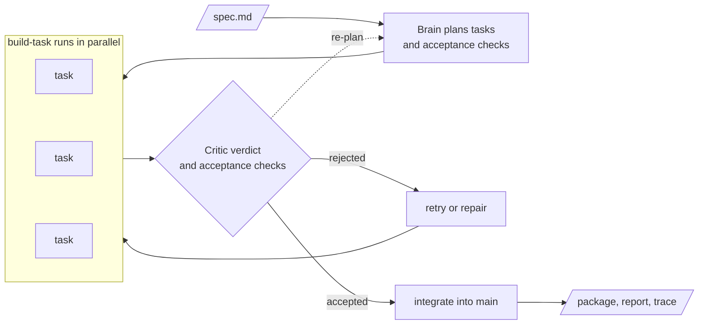

# Factory Layer

A software factory: give it a one-page product spec in Markdown and, with
one command, it plans the work, derives acceptance checks, drives coding
agents through a playbook runner, judges the results and recovers from
failures until it delivers a small TypeScript project (a CLI or an HTTP
API) whose tests pass. It is the JigJoy hackathon entry in the Software
Factory track.

Status: the factory delivers one-page CLI and HTTP API specs end to end,
with a cutoff, a hidden-run script and playbook authoring.

## How it works



1. **Brain.** Three concurrent Mozaik agents decide. The Architect plans
   the tasks, the Acceptance analyst turns the spec into acceptance checks
   (the spec's own examples become checks first), and the Critic reviews
   those checks and judges every finished task; a rejected task is
   retried, repaired or re-planned. The
   brain only decides; the application is the single writer of the run's
   state.
2. **Hands.** APB (Agentic Playbooks), driven through `apb mcp`, does the
   coding work. Each task is a `build-task` run: a coding agent builds,
   the package's quality gates and a reviewer agent run side by side, and
   up to two fix rounds on Sonnet are followed by one root-cause round on
   Opus. Several tasks run at once.
3. **Integration.** An accepted task is merged onto `main` only when the
   package steps and every check that passed before still pass. A merge
   conflict goes to the `integrate` playbook.
4. **Memory.** Open Second Brain recalls similar past runs before planning
   and remembers each outcome, in a vault of the factory's own.
5. **Delivery.** A clean copy of `main` is installed, built, tested and
   checked, then copied to the output directory.

The code is layered `domain` <- `ports` <- `application` <- `adapters` <-
`cli`. Details: [Playbooks and agent profiles](docs/guide/playbooks-and-profiles.md)
and [Development](docs/guide/development.md).

## What you get

1. **The package.** A TypeScript project on the factory's own stack
   (Bun, strict TypeScript, oxlint, oxfmt, Zod, `bun run check`) unless the
   spec names another one; its built output also runs under Node.
2. **The report.** `runs/<runId>/report.md`: tasks, attempts, models,
   and the time and cost of every task.
3. **The trace.** `runs/<runId>/trace.jsonl`: every transition and
   decision of the run, from which `factory report` rebuilds the report.
   Human interventions are recorded in it with `factory intervene`, and the
   hidden run copies each report and trace into `hidden/`.

## Quick start

Requirements (versions in [Setup](docs/guide/setup.md)):

1. Bun 1.4.4, git 2.28 or newer, Node.js with npm.
2. `apb` (Agentic Playbooks) and `o2b` (Open Second Brain) on `PATH`.
3. Claude Code, installed and logged in.

```bash
bun install
cp .env.example .env            # brain key and the memory vault paths
bun run apb:bootstrap           # approve the starter playbooks and profiles in APB
bun run factory doctor          # every line must pass
bun run factory run examples/specs/wordfreq.md
bun run hidden <spec-a>.md <spec-b>.md --cutoff 19:15   # the hidden specs, all at once
```

The brain runs on Z.ai `glm-5.3-flash` by default, or on Claude through
the JigJoy gateway with `FACTORY_BRAIN_GATEWAY=1`, falling back to Z.ai
automatically. The memory vault must be a dedicated one: see
[Setup](docs/guide/setup.md#a-dedicated-memory-vault).

## Documentation

1. [Setup](docs/guide/setup.md): requirements, macOS setup, the dedicated
   memory vault.
2. [Running the factory](docs/guide/running.md): commands, options, exit
   codes, the trust model, the end-to-end run.
3. [The hidden run](docs/guide/hidden-run.md): several specs at once
   against a cutoff, and the reports in `hidden/`.
4. [The demo](docs/guide/demo.md): the live demo and its offline replay.
5. [Configuration](docs/guide/configuration.md): every environment
   variable, brain providers and fallback.
6. [Playbooks and agent profiles](docs/guide/playbooks-and-profiles.md):
   `build-task`, `integrate`, the profiles, the APB trust bootstrap.
7. [Development](docs/guide/development.md): layers, check tiers,
   integration smokes.

## Development

`bun run check:fast` while working, `bun run check` (the full gate) before
delivery. The repository rules for contributors and coding agents are in
[AGENTS.md](AGENTS.md).
