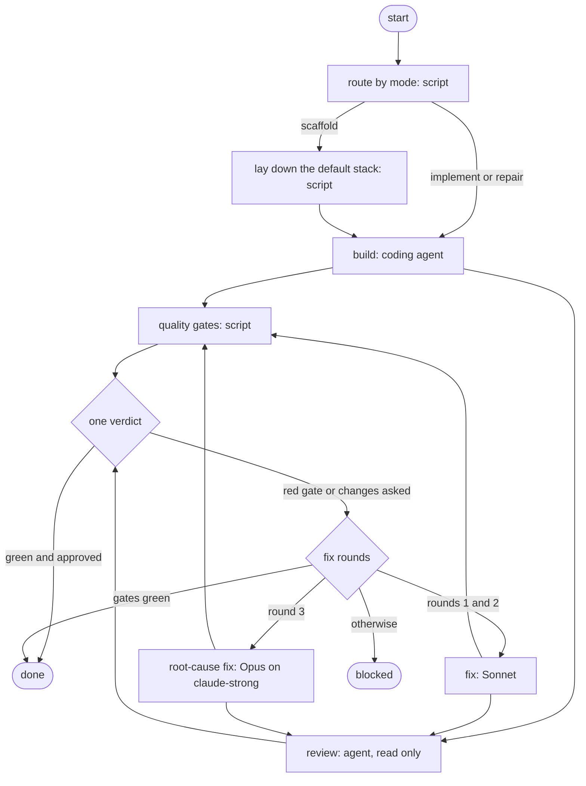
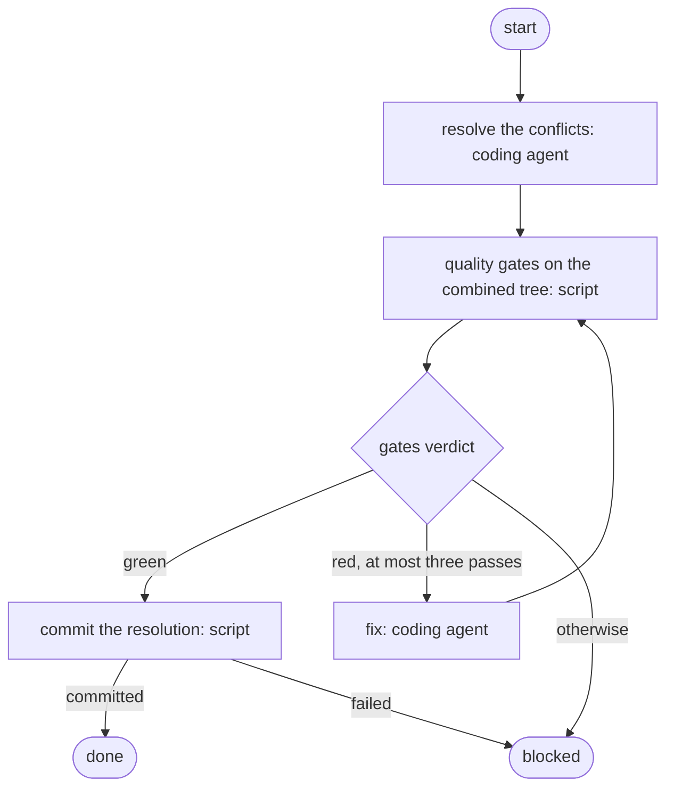

# Playbooks and agent profiles

The APB agent profiles, the two starter playbooks the factory runs
(`build-task` and `integrate`), the APB trust bootstrap and the smoke
playbooks. Back to the [README](../../README.md).

## Agent profiles

The coding work runs through APB agent profiles under `.apb/profiles/`, one
per supported agent CLI and named after it:

| Profile | Agent CLI | Model |
| --- | --- | --- |
| `claude` | Claude Code | `claude-sonnet-5-5` |
| `claude-strong` | Claude Code | `claude-opus-5-5` (the one escalated fix round of `build-task`) |
| `codex` | Codex | `gpt-6-sol` |
| `opencode` | opencode | `opencode/glm-5.3-flash-free` |
| `zcode` | ZCode | `GLM-5.3-Flash` |
| `agy` | agy | `gemini-3.8-flash-high` |
| `grok` | Grok | `grok-4.3` |

Each has no fallback and the same short role prompt (`SOUL.md`). The two
starter playbooks (`build-task`, `integrate`) default to `claude`. To run
them with another CLI, run the bootstrap with `--agent` (see
[APB trust bootstrap](#apb-trust-bootstrap)).

Claude Code loads every `CLAUDE.md` from its working directory up to the
filesystem root, and the task trees live inside this repository. The
factory therefore starts `apb mcp` with `CLAUDE_CODE_DISABLE_CLAUDE_MDS=1`
in its environment, which the agent processes inherit, so a coding agent
never sees this repository's own instructions. APB profiles choose which
variables an agent inherits but cannot set one, which is why the variable
comes from the factory and not from the profile.

## The starter playbooks

The factory runs only the two starters, which work in the task tree they
are given. Neither pushes; the factory commits a task's work itself.

### `build-task`

`build-task` (version 1.2.0, modes `scaffold`, `implement`, `repair`) has
13 nodes, counting its start and its two finish nodes `done` and
`blocked`. A script routes the run by mode; for a scaffold,
`scripts/stack.sh` lays down the factory's default stack (strict
TypeScript, oxlint, oxfmt, Bun tests, Zod and the gate scripts, tools
pinned). A coding agent builds, then two branches run side by side and join
into one verdict: `scripts/gates.sh` runs the package's own quality gates
(install, then `typecheck`, `lint`, `format:check`, `build` and `test`;
`typecheck`, `lint`, `format:check` and `test` are required, so a package
cannot skip them, and `build` runs when the package declares it) while a
reviewer agent reads the diff against the task. A red gate or a review
finding goes to a fix agent for at most two rounds, a still-red gate or a
review still asking for changes then gets one root-cause round on the
stronger `claude-strong` profile (Opus), and the run ends `done` or
`blocked` (green gates with a review still asking end `done`: the factory's
Critic and acceptance checks judge the result).



A failed route or stack script also ends the run `blocked`.

### `integrate`

`integrate` (version 2.0.0) runs only when merging a task onto `main` hits
a conflict: the factory merges `main` into the task branch in the task's
own tree and hands the conflict over. A coding agent resolves the merge
conflict, the same gates run on the combined tree with a fix loop (at most
three passes), and `scripts/record-resolution.sh` commits the resolution
only when they are green; otherwise the run ends `blocked` with the merge
unfinished.



## APB trust bootstrap

APB runs only playbooks and agent profiles that are approved in its trust
store, and the trust store belongs to the machine, not to the repository. On
a new machine, or after the profiles or the playbooks change, run:

```bash
bun run apb:bootstrap                 # starters keep their default profile
bun run apb:bootstrap --agent codex   # starters switched to the codex profile
```

From the repository root it:

1. re-writes every project profile under `.apb/profiles/` from its own
   `profile.yaml` and `SOUL.md`, which approves the profile's bundle, and
   checks that the write reports the bundle trusted, with no failed trust
   write and no unapproved skills;
2. with `--agent <cli>`, republishes the two starter playbooks through APB
   with that profile as their default (a new playbook version each; a
   starter that already defaults to it is left alone);
3. starts `apb mcp` and approves the two starters, then does the same
   for the `smoke`, `smoke-stall` and `smoke-fail` playbooks in their own
   APB project, `tests/integration/apb-fixture/`;
4. prints the trust list entries it created.

The playbooks are approved by explicit confirmation rather than by an APB
trial: APB cannot trial a script playbook before the repository has its
first commit, and it would trial a coding playbook in a worktree of this
repository instead of a task tree. Review them before the first bootstrap.

APB finds its trust store through `APB_CONFIG_DIR`, then
`XDG_CONFIG_HOME`, then `HOME`. Set `APB_CONFIG_DIR` to bootstrap and test
against an isolated trust store; the bootstrap and the smokes both honour
it.

## The smoke playbooks

The three smokes in `tests/integration/apb-fixture/` are single script
nodes with no model and no file writes: `smoke` prints one fixed line,
`smoke-stall` sleeps for an hour so the stop path can be exercised, and
`smoke-fail` exits 1 so a node failure can be observed. The smokes are test
fixtures of the APB adapter and live apart from the factory's playbooks.
How they are run: [Development](development.md#integration-smokes).
